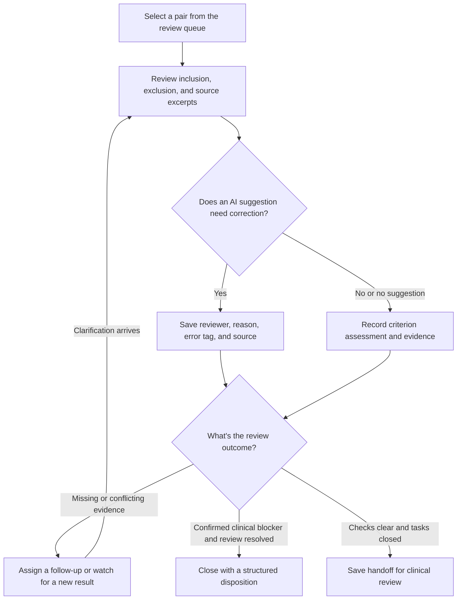

# Coordinator screening workflow

Each review starts from a possible patient–trial pair. The coordinator resolves evidence questions and records a next step. A qualified study team handles formal screening.

The [AI Evaluation Inspector](https://trial-review-desk-akshata.lovelybell1.chatgpt.site/#inspector) displays the original suggestion, the reviewer’s correction, and the evidence behind both. The benchmark uses a fixed set of seven fictional examples. The human-review counts use saved actions and distinguish unique suggestions from repeated overrides.

A watchlist event appends evidence and sends a criterion back to review. Closing a follow-up is a separate action. The visit brief summarizes reviewed evidence, the remaining question, and a proposed next action.
